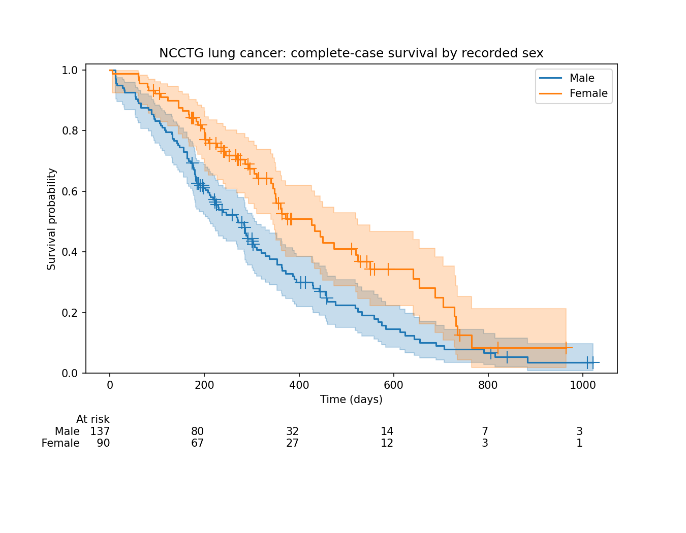
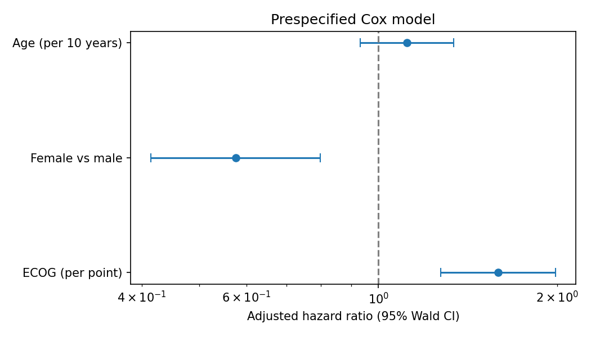
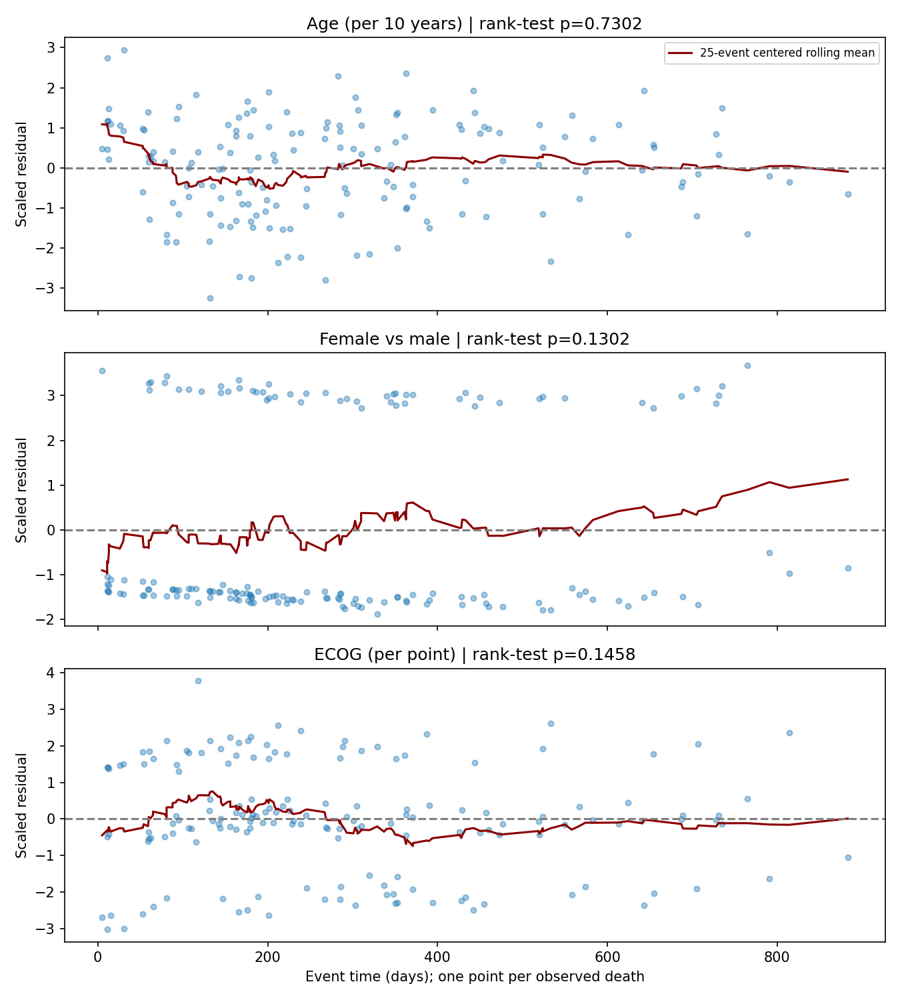

# Survival analysis — Kaplan–Meier and Cox

A reproducible methodological analysis of the public NCCTG advanced lung cancer
cohort. Estimates describe associations in a historical cohort; they are not
clinical recommendations.

## Question

How does observed survival differ by recorded sex, and how are age, sex and
physician-rated ECOG performance associated with mortality after mutual adjustment?

## Data

The [NCCTG lung cancer dataset](https://stat.ethz.ch/R-manual/R-devel/library/survival/html/lung.html)
is distributed here as the [lifelines v0.30.0 CSV](https://raw.githubusercontent.com/CamDavidsonPilon/lifelines/v0.30.0/lifelines/datasets/lung.csv).
The underlying study is Loprinzi et al., *Journal of Clinical Oncology* 12:601–607
(1994), cited in the dataset documentation. The download is pinned by version and
SHA-256; [provenance](data/raw/provenance.json) records the exact source.

**Coding matters:** this lifelines CSV already uses `status=1` for death and `0`
for right censoring. The R `survival` documentation uses `2` and `1`, respectively.
Applying R's recoding to this CSV would corrupt the outcome.

| Input | Meaning | Analysis use |
|---|---|---|
| `time` | Observed survival/follow-up in days | Duration |
| `status` | 1 death, 0 right censored | Event indicator |
| `age` | Age in years | Continuous, per 10 years |
| `sex` | Recorded male=1, female=2 | Female versus male |
| `ph.ecog` | Physician ECOG, increasing impairment | Ordinal linear term, per point |

There are **228 source records**. One missing ECOG value is excluded, leaving
**227 patients: 137 male, 90 female; 164 deaths and 63 censored observations**.
Missing unused variables do not cause exclusions. The processed CSV retains the
zero-based source row number for traceability; it is not a patient identifier.

## Approach

The [scope and acceptance criteria](docs/SCOPE.md) specify a single complete-case
cohort for every comparison, with no significance-driven covariate selection.

1. Kaplan–Meier curves by sex, pointwise 95% log-log confidence intervals, censor
   markers and numbers at risk at the start of each displayed time point.
2. One unweighted, two-sided log-rank comparison of the two survival curves.
3. Unpenalized multivariable Cox model with age per decade, female versus male,
   and ECOG per point. Efron tie handling, Breslow baseline hazard and Wald 95% CIs.
4. Rank-time tests of scaled Schoenfeld residuals for all three covariates,
   unadjusted alpha=0.05, plus residual plots with a 25-event centered rolling mean.

See the lifelines documentation for [Cox estimation](https://lifelines.readthedocs.io/en/latest/fitters/regression/CoxPHFitter.html),
[statistical tests](https://lifelines.readthedocs.io/en/latest/lifelines.statistics.html)
and [PH diagnostics](https://lifelines.readthedocs.io/en/latest/jupyter_notebooks/Proportional%20hazard%20assumption.html).

## Results

All values below come from the executed pipeline and are available at higher
precision in the CSV tables and [generated report](results/report.md).

Median KM survival was **270 days for male patients and 426 days for female
patients**. The unadjusted log-rank statistic was **10.008174** (1 degree of
freedom), **p=0.00155847**.

| Adjusted covariate | Hazard ratio | 95% CI | Wald p |
|---|---:|---|---:|
| Age, per 10 years | 1.1170 | 0.9315–1.3395 | 0.232417 |
| Female versus male | 0.5754 | 0.4142–0.7994 | 0.000986089 |
| ECOG, per point | 1.5900 | 1.2727–1.9864 | 0.0000444713 |

Female sex was associated with lower mortality hazard and higher ECOG with higher
hazard after mutual adjustment. The age interval includes 1. These associations
are not causal effects. Training-data concordance was **0.637135**, an apparent
fit statistic without held-out validation.





Rank-transformed scaled Schoenfeld test p-values were **0.730152 for age**,
**0.130229 for female sex**, and **0.145831 for ECOG**: **0/3 tests flagged** at
alpha=0.05. Failure to reject does not establish PH. The female residual smoother
rises during sparse late follow-up; constant hazard ratios remain an assumption,
with uncertainty that the test cannot rule out. No global PH test or multiplicity
correction was performed.



## Reproduce

Requires Python 3.11. Run from the repository root:

```bash
python3.11 -m venv .venv
source .venv/bin/activate
python -m pip install -r requirements.lock.txt
python -m pip install --no-deps --no-build-isolation -e .

# Optional: refetch the exact public source; checked-in data supports offline runs.
python scripts/download_data.py

python -m survival_analysis analyze
python -m survival_analysis verify
python -m pytest -q
```

`requirements.txt` records direct dependencies; `requirements.lock.txt` pins the
resolved environment. Only fetching and package installation require network
access. The analysis and tests use the checked-in source offline. An alternate
output root is supported with `python -m survival_analysis analyze --root PATH`
when `PATH/data/raw/lung.csv` contains the validated source.

## Outputs and verification

| Artifact | Contents |
|---|---|
| `data/raw/lung.csv`, `provenance.json` | Exact public input and source checksum |
| `data/processed/analysis.csv` | 227 complete cases with modeled variables |
| `results/cohort_summary.csv`, `missingness.csv` | Cohort accounting and required-field missingness |
| `results/km_curves.csv`, `at_risk.csv` | Sex-specific estimates, pointwise CIs, start-of-time risk counts |
| `results/logrank.csv` | Test statistic and p-value |
| `results/cox_model.csv` | 3 coefficients, HRs, 95% CIs, SEs and p-values |
| `results/ph_test.csv`, `schoenfeld.csv` | 3 PH tests and residuals for 164 deaths |
| `results/*.png` | 3 figures shown above |
| `results/summary.json`, `report.md` | Machine-readable and narrative results |
| `results/manifest.json` | SHA-256 digests for 14 artifacts, including processed data |

The result directory contains **8 CSVs + 3 PNGs + 3 JSON/Markdown files = 14
files**. The manifest hashes the other 13 result files plus the processed CSV;
its own digest is not self-referential.

**21 pytest cases pass** locally, exceeding the acceptance minimum of 12. Tests
cover hand-calculated KM behavior with censoring/ties, binary coding and invalid
inputs, complete-case accounting, an independently implemented Efron partial
likelihood optimized with SciPy, numerical regression fixtures, PNG integrity,
PH-flag disclosure, artifact tampering, and unchanged files after failed downloads.
Regression fixtures are from the pinned run, not external validation.

[GitHub Actions](https://github.com/Akkaya-Furkan/survival-analysis/actions/workflows/ci.yml)
installs the locked environment, refetches the checksum-validated source, runs the
tests, regenerates/verifies outputs and uploads an analysis artifact bundle.

## Limitations

- Historical observational advanced lung cancer cohort; generalization and
  unmeasured confounding limit interpretation. Sex is the dataset's recorded
  binary variable; no treatment effect is estimated.
- Independent/noninformative right censoring is assumed and cannot be established
  from this table. Late follow-up has small risk sets and broad uncertainty.
- Complete-case exclusion can introduce bias. Multiple imputation: **not done**.
- Age and ECOG have linear effects on log hazard; ECOG is treated as an ordinal
  linear score. Nonlinear functional-form assessment: **not done**.
- PH tests are covariate-wise with finite power; no detected violation is not
  proof of proportionality. Global PH test, time-varying coefficient analysis and
  PH-remedial refits: **not done**.
- External validation, held-out predictive evaluation, causal inference and
  TCGA/cBioPortal integration: **not done**.
